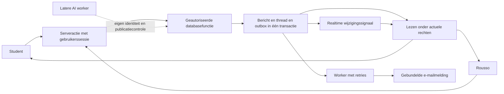

# Implementatieplan voor de privéchat met Rousso

Datum: 14 oktober 2026. Status: privacy/routing live; nieuwe berichtkern, interface, screenshots en mailoutbox lokaal gebouwd. Zie [uitvoering, verificatie en uitrol](MENTOR_CHAT_ROLLOUT.md) voor het onderscheid en de resterende productievrijgave. Onderstaande analyse beschrijft de oorspronkelijke uitgangssituatie en het volledige ontwerp.

Alle ingelogde platformleden, ook gratis studenten, moeten Rousso zonder betaalmuur of verplichte intake kunnen bereiken. De chat ondersteunt persoonlijke begeleiding en kan leiden tot een call of mentorship. Daarvoor moet de eerste vraag eenvoudig te stellen zijn en moet Rousso één betrouwbare werkvoorraad hebben.

Het voorstel is de bestaande Next.js-, Supabase- en Netlify-basis te versterken. Gesprekken en berichtgeschiedenis blijven behouden. Eerst worden exclusieve toegang voor student en Rousso, betrouwbaar verzenden en een veilige inbox afgedwongen. Daarna volgen notificaties, screenshots en afwerking. Het datamodel krijgt ruimte voor AI, terwijl de eerste release volledig menselijk blijft.

## 1. Productafspraken

- Iedere student heeft één doorlopend privégesprek met Rousso. Een nieuwe vraag vanuit een les opent datzelfde gesprek, eventueel met een zichtbare lesverwijzing.
- Alle ingelogde studenten mogen lezen en schrijven, onafhankelijk van aankoop of mentorship. Een latere productwijziging moet expliciet gebeuren; betaalstatus verleent geen mentor- of beheerrechten.
- Alleen de betreffende student en Rousso krijgen reguliere toegang tot het gesprek. Andere beheerders krijgen geen chatinhoud, previews, meldingen of ongelezen aantallen over deze gesprekken.
- Rousso is een geverifieerd account met een expliciete chatmentorrol. Zijn naam is presentatie; zijn stabiele account-ID bepaalt routing en rechten.
- De interface toont Rousso als ontvanger en een configureerbare antwoordverwachting. Een actieve websocket betekent niet dat Rousso online of onmiddellijk beschikbaar is.
- De eerste vraag vereist alleen berichttekst. Geen aanvraagformulier, betaalstap of afspraak voordat iemand kan schrijven.
- Rousso kan in een passend gesprek een call of mentorship voorstellen via een gewone link of duidelijke CTA. Een verkoopflow mag de hulpvraag niet blokkeren.
- Platformmedewerkers met database- of servicecredentials blijven technisch bevoorrecht. Die operationele toegang wordt beperkt en gecontroleerd; de chat krijgt geen claim van end-to-end-encryptie.

De concrete UUID van Rousso, de antwoordverwachting en de links voor call/mentorship worden bij inrichting bevestigd. Bij ontbrekende of ongeldige mentorconfiguratie stopt verzending met een herstelbare melding; er is geen terugval naar alle admins.

## 2. Wat al bestaat en wat eerst moet veranderen

De huidige basis bevat afzonderlijke gesprekken en berichten, RLS, een uniek standaardgesprek per student, een client-ID voor studentberichten, interne notities, realtime abonnementen, inboxstatussen en notificaties die samen met het bericht worden opgeslagen. Deze onderdelen blijven bruikbaar.

| Prioriteit | Vastgesteld in de huidige code | Gevolg en benodigde verandering |
| --- | --- | --- |
| P0 | De nieuwste berichttrigger kiest alle accounts met `access_level = 3` als ontvanger. `supabase/migrations/20260927040000_mentor_reply_author.sql:60` | Studentvragen worden naar alle beheerders gerouteerd. Gebruik uitsluitend de toegewezen mentorparticipant. |
| P0 | Chatpolicies geven alle admins lees- en schrijfrechten. Assignment beperkt toegang niet. `supabase/migrations/20260615000000_mentor_chat_notifications.sql:368` en `:405` | Alleen ontvangers aanpassen beschermt gesprekken onvoldoende. Alle chatpaden moeten actuele deelname controleren. |
| P0 | Notificatieautorisatie bevat een algemene adminuitzondering; meldingen bevatten maximaal 240 tekens berichttekst. `supabase/migrations/20260927010000_notification_visibility_by_role.sql:12`; `20260927040000_mentor_reply_author.sql:54` en `:101` | Privétekst blijft anders via notificaties leesbaar. Pas event-, recipient- en shelltoegang samen aan en behandel historische meldingen. |
| P0 | In het ongelezenfilter kan lezen de geselecteerde thread uit de lijst verwijderen. De selectie valt dan terug op een andere student, terwijl de composer niet per thread is gekoppeld. `lib/mentor-chat.ts:296`; `components/admin/MentorInbox.tsx:69` en `:238` | Concepttekst kan bij de verkeerde student terechtkomen. Zet selectie vast en bewaar een afzonderlijke composer per gesprek. Dit scenario moet vóór release in de browser worden getest. |
| P1 | Student laadt de oudste 100 berichten; mentor de oudste 150. `lib/mentor-chat.ts:115` en `:327` | Nieuwe berichten verdwijnen na de limiet. Laad de nieuwste pagina en maak alle historie bereikbaar. |
| P1 | Read-RPC's zetten de volledige unreadcounter op nul. `supabase/migrations/20260615000000_mentor_chat_notifications.sql:312` | Niet geladen of net ontvangen berichten kunnen als gelezen gelden. Bewaar per deelnemer een gelezen berichtgrens. |
| P1 | Iedere mentorverzending krijgt op de server een nieuwe UUID. `lib/mentor-chat.ts:353` | Herhalen na een verloren antwoord kan dubbel verzenden. Gebruik dezelfde client-ID tot de opslag bevestigd is. |
| P1 | Realtime heeft geen eigen status- of herstelafhandeling; de inbox toont altijd Live. `lib/realtime-hooks.ts:70`; `components/admin/MentorInbox.tsx:111` | De interface kan actuele ontvangst suggereren terwijl updates ontbreken. Toon de werkelijke verbindingstoestand en haal gemiste berichten op. |
| P2 | Inbox beperkt eerst op 40 gesprekken en zoekt daarna in geheugen; previews laden alle berichten van die threads. `lib/mentor-chat.ts:200`, `:249` en `:270` | Oudere studenten zijn niet vindbaar en de query groeit onnodig. Zoek en pagineer in de database, met één preview per gesprek. |

Dit zijn bevindingen uit code en migraties, geen verklaring over welke migraties al in productie actief zijn. De inventaris van live policies, grants en functies is onderdeel van de eerste uitvoeringsfase.

## 3. Architectuur en datamodel

PostgreSQL blijft de bron van waarheid. De client bewaart concepten en tijdelijke verzendstatus; realtime signaleert wijzigingen; een worker verzorgt externe notificaties nadat een bericht is opgeslagen.

We behouden `conversation_threads` en `conversation_messages`; een nieuwe, parallelle chatdatabase is onnodig. De onderstaande namen voor nieuwe velden en functies zijn uitvoeringsvoorstellen.

| Onderdeel | Uitbreiding en verantwoordelijkheid |
| --- | --- |
| `chat_principals` | Afzenderidentiteit van type `human`, `ai` of `system`. Een menselijke principal verwijst naar een geverifieerd platformaccount. Alleen vertrouwde serverlogica kan AI- en systeemidentiteiten gebruiken. |
| `conversation_participants` | Principal, gesprek, rol, actieve/ingetrokken deelname en `last_read_public_seq`. Nu precies de student en Rousso; later kan een AI deelnemen. De student kan zelf geen deelnemers toevoegen of rollen wijzigen. |
| `conversation_threads` | Bestaande ID en studentkoppeling behouden. Toevoegen: modus met standaard `human`, transactionele teller voor publieke berichten, verwijzing naar laatste publieke bericht en een versie voor latere AI-overdracht. |
| `conversation_messages` | Toevoegen: principal/participant als afzender, publieke volgnummering en berichttype. Nieuwe berichten vereisen een client-ID. Bestaande afzendervelden blijven tijdens overgang compatibel en worden door de database gevuld. |
| `conversation_attachments` | Bericht, uploader, private objectreferentie, gevalideerd type/grootte en lifecycle. Geen publieke bestands-URL als bronrecord. |
| `chat_notification_outbox` | Duurzame externe notificatietaken met ontvanger, deduplicatiesleutel, lease, pogingenteller, volgende poging en eindstatus. |
| Interne notities | Eigen stafftabel of strikt gescheiden projectie en activiteitenvelden. Ze beïnvloeden geen studentpreview, publieke volgnummering of studentnotificatie. |

De deelnemerslijst is de autorisatiebron. `assigned_to_student_id` kan tijdelijk als compatibiliteitsveld blijven bestaan, maar mag geen tweede, onafhankelijk wijzigbare waarheid worden. Foreign keys en databasecontroles borgen dat een afzenderparticipant tot hetzelfde gesprek behoort. Indexen ondersteunen `(thread_id, public_seq)`, unieke idempotency keys en de inboxvolgorde.

### Exclusieve toegang voor Rousso

Een beschermde configuratie wijst naar Rousso's principal. Het aanmaken van een gesprek, toevoegen van beide deelnemers en versturen van het eerste bericht gebeuren in één transactie. Alleen een pagina bezoeken creëert geen zichtbare, lege werktaak.

De bestaande unieke standaardthread per student blijft afgedwongen. Twee eerste verzendingen vanuit verschillende tabs maken samen één gesprek, met ieder bericht eenmaal. Een nieuwe studentvraag heropent een gesloten gesprek atomair en zet het op wachten op Rousso.

Serveracties gebruiken de geverifieerde gebruikerssessie en dezelfde autorisatieregels als de database. Normale chatverzending gebruikt geen service role. Directe clientmutaties van messages, threadstatus, deelnemers, events en ongebruikte reacties worden ingetrokken; afgebakende RPC's vormen de schrijfinterface.

De chat krijgt een eigen mentorautorisatie en waar nodig een eigen layout voor de inbox. De bestaande inboxcomponent kan worden hergebruikt. Een eventuele oude admin-URL blijft alleen voor de bevoegde mentor als redirect beschikbaar. Rousso hoeft voor chattoegang geen algemene beheerrechten te krijgen. Een smalle profielprojectie levert uitsluitend de naam, avatar en noodzakelijke context van zijn eigen gesprekspartners.

De beperking geldt ook voor algemene admindashboards, exports, zoekresultaten, conversation-events, notificaties, opslag en realtime. De bestaande `mark_mentor_conversation_read` en notificationhelper moeten worden aangepast: hun huidige admincontrole mag geen achterdeur blijven.

Een extra beperkende policy toevoegen naast een oude permissieve policy is onvoldoende: PostgreSQL combineert permissieve policies met OR. De brede chatuitzonderingen moeten gericht worden vervangen of ingetrokken. [PostgreSQL RLS](https://www.postgresql.org/docs/current/ddl-rowsecurity.html)

## 4. Betrouwbaar verzenden en lezen

### Eén opgeslagen bericht per verzendintentie

Beide clients genereren één UUID wanneer een nieuw bericht wordt aangeboden. Die sleutel blijft gelijk bij dubbelklikken, time-outs en opnieuw proberen. De server retourneert het canonieke opgeslagen bericht, inclusief ID, serverdatum en volgnummer.

Een voorgestelde `send_chat_message`-RPC voert het volgende uit:

1. Verifieer identiteit en actieve deelname. Afzender, rol, tijdstip en interne vlag komen niet ongecontroleerd uit de browser.
2. Lock de threadrij; controleer onder die lock of dezelfde afzender en client-ID al bestaan. Geef een bestaande poging terug vóór nieuwe quota of uploadvoorwaarden worden toegepast. Dezelfde sleutel met andere inhoud levert een conflict op. Voor een nieuw bericht volgen invoer-, bijlage- en limietcontroles. Deelname intrekken gebruikt dezelfde lockafspraak, zodat autorisatie tijdens een write niet kan verschuiven.
3. Verhoog de publieke teller voor een openbaar gespreksbericht en sla het bericht op. Houd de lock vast tot commit, zodat een hoger volgnummer niet eerder zichtbaar kan worden dan een lager nummer.
4. Werk publieke preview, antwoordstatus en eventuele caches bij. Maak in dezelfde transactie het in-app event, de benodigde auditmetadata en de externe notificatietaak aan.
5. Commit en geef het opgeslagen bericht terug. Een latere mailfout verandert een succesvol opgeslagen bericht niet in een mislukte verzending.

Per gesprek serialiseren we alleen de korte databasebewerking; uploads, mails en AI-aanroepen draaien buiten de lock. Dit gebruikt normale PostgreSQL-transacties en rijlocks. [PostgreSQL locking](https://www.postgresql.org/docs/current/explicit-locking.html)

De bestaande trigger wordt hierbij aangepast of vervangen, zodat niet zowel de RPC als de oude trigger counters en notificaties aanmaken. Toepassings- en databasevalidatie controleren onder meer de bestaande grens van 5.000 tekens. Start met een configureerbare limiet, bijvoorbeeld 10 nieuwe berichten per minuut per afzender, plus uploadquota. Een retry van hetzelfde bericht verbruikt geen nieuwe verzendquota.

De UI onderscheidt `wordt verzonden`, `verzonden` en `mislukt — opnieuw proberen`. `Verzonden` betekent dat PostgreSQL het bericht heeft opgeslagen. Een gelezen-indicator gebruikt de cursor van de ontvanger. `Afgeleverd` wordt alleen toegevoegd met een afzonderlijke ontvangstbevestiging; een websocketverbinding bewijst dat niet.

### Historie en gelezenstatus

- Laad eerst de nieuwste 50 publieke berichten, render ze chronologisch en laad oudere pagina's met een stabiele cursor. Gebruik geen offsetpaginering voor veranderende gesprekshistorie.
- Ligt de eerste ongelezen vraag vóór die pagina, haal dan ook de pagina rond die ongelezen grens op en open daar. Een readcursor mag niet stilzwijgend over een ongelezen, niet geladen achterstand springen. De cursor schuift over een aaneengesloten bekeken grens; een sprong naar het nieuwste bericht is geen automatische bevestiging van de overgeslagen achterstand.
- Haal nieuwere berichten op via `after_seq`. Voeg resultaten op ID samen en voorkom dubbele weergave bij tegelijk ontvangen serverresponses en realtime events.
- Een deelnemer markeert uitsluitend tot de werkelijk zichtbare berichtgrens als gelezen, in een actieve zichtbare tab. De server accepteert alleen een toegankelijke publieke grens en verhoogt de cursor met `GREATEST`.
- Een nieuw bericht boven die grens blijft ongelezen, ook wanneer verzenden en lezen tegelijk gebeuren. Eigen berichten tellen niet als ongelezen inkomende berichten.
- Deelnemercursors zijn leidend; eventuele unreadcaches zijn transactioneel onderhouden en herstelbaar. Een melding openen of alle meldingen wegwerken markeert niet automatisch het gesprek gelezen.
- Interne notities hebben geen publieke volgnummering en veranderen geen publieke activiteitstijd. Gebruik voor studenten een beperkte threadprojectie, zodat interne velden niet alsnog via dezelfde rij zichtbaar zijn.

### Realtime en herstel

Voor de eerste release kan de bestaande Postgres Changes-integratie blijven, met strikte tabel-RLS en beperkte abonnementen. Een kanaalfilter is geen autorisatiecontrole. Supabase documenteert dat Postgres Changes rekening houdt met leesrechten; Broadcast en Presence hebben eigen kanaalautorisatie. [Supabase autorisatie](https://supabase.com/docs/guides/realtime/authorization)

Voeg statusafhandeling, herverbinden en ophalen van gemiste berichten toe. Eerst abonneren en daarna de huidige databasegrens ophalen sluit de laad/subscribe-race; dubbele events worden samengevoegd. Herstel loopt ook bij reconnect, focus, terugkeer uit een achtergrondtab en een online-event. Zolang de chat actief is, controleert een beperkte periodieke query op gemiste updates. Realtime is geen zelfstandig bewijs dat de client volledig bij is. [Supabase troubleshooting](https://supabase.com/docs/guides/troubleshooting/realtime-postgres-changes-troubleshooting)

Toon `verbonden`, `opnieuw verbinden` of `offline`. Berichten worden nooit uitsluitend via de websocket verstuurd. Bij sessieverloop blijft het concept behouden en is opnieuw inloggen mogelijk. In deze release vereist verzenden vanuit offline toestand een expliciete herhaalactie, zodat een oud concept niet onverwacht later wordt verstuurd.

Private Broadcast is een mogelijke latere transportverbetering bij grotere volumes. Gebruik dan beperkte wijzigingssignalen en haal inhoud opnieuw op onder actuele rechten. Kanaaltoegang kan tijdens een verbinding gecachet zijn; ingetrokken deelname moet ook voor bestaande verbindingen worden getest. [Supabase database changes](https://supabase.com/docs/guides/realtime/subscribing-to-database-changes), [Supabase kanaaltoegang](https://supabase.com/docs/guides/realtime/authorization)

## 5. Studentervaring en Rousso's inbox

De student ziet een herkenbare chat met Rousso, een korte antwoordverwachting en één duidelijke composer. Een knop op het dashboard, een vaste navigatie-ingang en een contextuele ingang bij lessen brengen de student naar hetzelfde gesprek. Een lesverwijzing is zichtbaar en controleerbaar; de server verifieert toegang tot de genoemde les. Een ongeldige of inmiddels ontoegankelijke lescontext kan worden verwijderd zonder de gewone vraag te blokkeren. De eerste chat werkt direct na registratie, ook als het platformprofiel nog moet worden aangemaakt.

Concepten zijn gekoppeld aan ingelogd account én gesprek. Voor herstel binnen dezelfde browsersessie kan `sessionStorage` worden gebruikt, met een beperkte bewaartijd en opruimen bij logout/accountwissel. Onbeperkte lokale opslag van privétekst wordt vermeden. Na een mislukte verzending blijven tekst, bestanden en dezelfde client-ID beschikbaar.

Wie historie terugleest, blijft op dezelfde scrollpositie. Nieuwe berichten tonen dan een knop om naar beneden te springen. Oudere pagina's laden verschuift het zichtbare bericht niet. Op mobiel blijven de composer, veilige schermranden en het schermtoetsenbord bruikbaar.

Rousso's inbox krijgt:

- Filters voor wachten op Rousso, ongelezen, wachten op student en gesloten. Snoozen krijgt pas betekenis met een concreet eindtijdstip en herstel van de taak op dat tijdstip.
- Een compacte rij met student, laatste publieke bericht, activiteit, ongelezen aantal en wachttijd. Interne notities veranderen geen studentzichtbare preview.
- Databasezoekfunctie en paginering over alle bevoegde gesprekken. Zoeken ondersteunt studentnaam en de volledige publieke berichtgeschiedenis; interne notities hebben een afzonderlijke staffscope. Een gerichte query levert één laatste bericht per thread; geen download van volledige geschiedenissen voor previews.
- Een vast geselecteerd gesprek, ook als lezen of antwoorden de filterresultaten wijzigt. Een ontoegankelijk geworden gesprek sluit met duidelijke feedback; het wisselt nooit stilzwijgend naar een andere student.
- Een composer en concept per thread. De verzendactie legt thread-ID, tekst, client-ID en interne/notitie-modus vast vóór de request. Statusvelden en checkbox resetten bij een echte gespreksswitch.
- Een duidelijk afgescheiden interne notitiemodus en een bevestigde openbare antwoordknop. Een interne notitie verstuurt nooit een studentmelding.
- Een badge voor nieuwe chatberichten in de mentornavigatie en bij de student, met dezelfde serverbetekenis als de inbox.

Voor toegankelijkheid krijgen formulieren zichtbare labels, fouten een live-melding, berichten een passende logstructuur en acties toetsenbordbediening. Bij Nederlandse invoer is verzenden met een zichtbare knop altijd mogelijk; eventuele Enter-shortcuts respecteren Shift+Enter en tekstcompositie. Check lichte/donkere modus en schermbreedtes van circa 390, 768 en 1440 pixels.

Voor de upsell meten we uitsluitend noodzakelijke events: ingang van het gesprek, eerste vraag, eerste mentorantwoord en klik op een vrijwillige call/mentorship-CTA. Berichtinhoud gaat niet naar analytics. Een klik telt niet als bevestigde afspraak of verkoop. Een uitgebreid CRM of automatische salesbot hoort niet bij deze release.

## 6. Notificaties en bestanden

### In-app en e-mail

Nieuwe studentvragen leveren alleen Rousso een in-app chatmelding op. Mentorantwoorden leveren alleen de betrokken student een melding op. Chattoegang wordt opnieuw gecontroleerd bij event/recipientselectie en bij de notification shell. Algemene platformnotificaties behouden hun eigen beleid.

Nieuwe notification-events bevatten een generieke melding en een bericht-/threadreferentie. Een benodigde preview wordt onder chatrechten opgehaald; de notificatietabel krijgt geen nieuwe kopie van de privéberichttekst.

De repository bevat nog geen volledige externe chatnotificatieflow. E-mail wordt daarom een afzonderlijk werkpakket met providerconfiguratie en een daadwerkelijk geplande worker. Hergebruik het bestaande lease/retry-patroon uit de transcriptieworkflow, met eigen chattaken en autorisatie; die huidige workflow is handmatig gestart en geen kant-en-klare chatscheduler.

De worker bundelt bijvoorbeeld vijf berichten gedurende twee minuten tot één melding per gesprek en ontvanger. Vóór versturen controleert hij opnieuw deelname, actuele gelezenstatus en voorkeuren. Stuur geen mail voor berichten die inmiddels gelezen zijn. Gebruik een generieke tekst en een geauthenticeerde link, zonder berichtinhoud of bijlage in de mail.

Unieke delivery keys, provider-idempotentie waar beschikbaar, leases en retries beperken duplicaten. Provideracceptatie is een andere status dan inboxbezorging. Bij een onduidelijke provider-time-out kan externe aflevering niet zonder meer exact eenmaal worden gegarandeerd; leg de poging vast en herstel gecontroleerd. Na herhaalde fouten blijft de taak zichtbaar voor operationele opvolging.

Historische chatrecipientrows van andere admins worden ontoegankelijk gemaakt en gericht opgeruimd volgens het gekozen bewaarbeleid. Alleen archiveren verhelpt geen te brede eventpolicy. Historische meldingen worden niet opnieuw als e-mail verstuurd.

### Eerst screenshots

Voor tradingvragen zijn charts en screenshots een logische eerste bijlage. Start met PNG, JPEG en WebP; maximaal 4 MB per bestand en drie bestanden per bericht, met een aanvullende pixelgrens. Upload ieder bestand afzonderlijk via een specifieke API-route en controleer de bytegrens voordat het volledig wordt verwerkt. Deze startwaarden passen bij de huidige Netlify-basis: gebufferde payloads zijn begrensd op 6 MB, effectief circa 4,5 MB voor binaire requests. Grotere uploads vereisen een ander uploadpad, bijvoorbeeld rechtstreeks naar private quarantaineopslag met validatie achteraf. [Netlify function limits](https://docs.netlify.com/build/functions/configuration/)

Uploads worden op daadwerkelijke bytes gecontroleerd, volledig gedecodeerd en opnieuw gecodeerd, met behoud van chartleesbaarheid en beeldverhouding. Verwijder metadata, gebruik willekeurige objectpaden en weiger SVG/HTML. De bestaande avatarverwerking biedt hiervoor bruikbare principes, maar de vierkante avataruitsnede wordt niet hergebruikt.

Een upload wordt geregistreerd als pending en alleen na validatie ready. De send-RPC koppelt alleen ready bestanden van de juiste uploader en thread aan een bericht. Tot die koppeling mag alleen de uploader het bestand lezen. Daarna moet ook het gekoppelde bericht toegankelijk zijn: alleen deelname aan de thread verleent geen toegang tot een interne bijlage. Registratie en definitieve opslag verwerken ook het eerste bericht, waarvoor nog geen thread bestaat, via een eigen uploadintentie. Mislukte/onafgeronde uploads en bestanden zonder referentie worden met een herhaalbare cleanup opgeruimd. Filevalidatie vereist meer dan een MIME-header of extensie. [OWASP uploads](https://cheatsheetseries.owasp.org/cheatsheets/File_Upload_Cheat_Sheet.html)

Bestanden staan in een private bucket met dezelfde deelnemersgrens als het gesprek. Gebruik bij voorkeur een geauthenticeerde downloadroute die opnieuw autoriseert, met `private, no-store` en `nosniff`, zoals het bestaande patroon voor private marktbeelden. Kort geldige signed URLs zijn een alternatief met een bewuste geldigheidsduur: een eenmaal uitgegeven link blijft tot zijn vervaldatum bruikbaar. [Supabase private buckets](https://supabase.com/docs/guides/storage/buckets/fundamentals), [Supabase downloads](https://supabase.com/docs/guides/storage/serving/downloads)

PDF's volgen pas nadat quarantaine, malwarescanning, veilige weergave/download en herstel bij scanfouten zijn ingericht. Zo blijft de eerste release met screenshots afgebakend en kan PDF-ondersteuning gecontroleerd volgen.

## 7. AI voorbereiden zonder de menselijke chat te veranderen

De huidige Mentor Copilot gebruikt profiel, voortgang, intake en mentor-notities. Hij leest de mentorchat nu niet. De bestaande AI-tabellen zijn admin-only en vormen geen geschikte studentchat-API.

We leggen nu de afzenderidentiteiten, deelnemers, berichttypen, modus en publicatiegrenzen vast. We activeren nog geen model, automatische verwerking van gesprekshistorie of AI-antwoord. Later wordt een AI een eigen deelnemer met een zichtbare naam; een AI-bericht verschijnt nooit als geschreven door Rousso.

De eerste AI-stap is een conceptantwoord dat Rousso controleert. Studentgerichte AI volgt pas met duidelijke productcommunicatie en een vastgesteld beleid voor contextselectie, verwerking en bewaring. Interne notities worden niet standaard aan een studentgerichte assistent meegegeven.

Een latere `ai_runs`-tabel bewaart triggerbericht, model-/promptversie, gebruikte contextreferenties, runstatus en kostenmetadata. Antwoordgeneratie draait in een afzonderlijke worker. Publiceren gebruikt een vertrouwde, beperkte databasefunctie die opnieuw controleert of de run nog actueel is, deelname geldig is en de gesprekmodus publicatie toestaat.

Bij menselijke overname verhoogt een gesprekversie. Een oude of herhaalde AI-run mag daarna geen antwoord meer publiceren. AI krijgt geen algemene beheerrechten; eventuele tools krijgen eigen toegangschecks. De huidige afspraak dat AI uitsluitend in eigen `ai_*`-tabellen schrijft, blijft gelden totdat de beperkte chatpublicatiefunctie expliciet als nieuwe architectuurstap wordt ingevoerd. Zie `docs/ai/AI_DATA_STRATEGY.md` en `docs/ai/AI_ARCHITECTURE.md`.

## 8. Uitvoeringsvolgorde

| Fase | Op te leveren | Klaar wanneer |
| --- | --- | --- |
| 0. Inrichting en nulmeting | Live schema/grants/policies controleren, Rousso's ID en chatrol instellen, antwoordverwachting vastleggen, bestaande aantallen en historische distributie inventariseren. | De juiste ontvanger is eenduidig; testaccounts en herstelprocedure zijn beschikbaar. |
| 1. Privacy en routing | Principals/deelnemers, Rousso als enige mentor, beperkte profielprojectie, gerichte vervanging van brede chat-/notificatierechten en read-RPC's. | Student A/B en andere admin kunnen elkaar niet lezen of beïnvloeden, ook via directe API, shell, events en realtime. |
| 2. Berichtkern en veilige inbox | Transactionele send-RPC, beide client-ID's, publieke volgnummering, cursors, nieuwste pagina, databasezoekfunctie, vastgezette selectie en threadgebonden concepten. | Geen dubbel bericht bij retries; geen verkeerd geadresseerd concept; 300+ berichten blijven bereikbaar. |
| 3. Ontvangst en meldingen | Reconnect/focus-herstel, juiste verbindingstoestand, badges, in-app autorisatie, outbox, bundeling, voorkeuren en geplande mailworker. | Offlineherstel is volledig; alleen de juiste ontvanger wordt gemeld; workerfouten zijn zichtbaar en herstelbaar. |
| 4. Screenshots en afwerking | Private uploads/downloads, cleanup, chartpreviews, mobiele composer, scrollgedrag en toegankelijkheid. | Bijlagen kunnen niet via een andere gebruiker worden opgevraagd en de kernflow werkt op mobiel en toetsenbord. |
| 5. Pilot en vrijgave | Productiecontrole, monitoring, back-uphersteltest en pilot met Rousso en enkele gratis/betalende studenten. | Alle verplichte scenario's hieronder slagen; rollback behoudt de aangescherpte rechten. |

De concrete codewijzigingen liggen vooral in `lib/mentor-chat.ts`, de twee chat-serveractionbestanden, beide chatpanelen, `lib/realtime-hooks.ts`, notificatiehelpers/-componenten, student- en mentornavigatie, `lib/types.ts`, nieuwe SQL-migraties en nieuwe integratietests. Nieuwe opslag-/workerfuncties worden afzonderlijk toegevoegd.

Werkinschatting: ongeveer drie tot vijf ontwikkelweken voor één ontwikkelaar, inclusief echte database-/browsertests en pilot, bij een werkende stagingomgeving. Dit is een planningsrange; fase 0 maakt afhankelijkheden rond e-mail, bestaande productiepolicies en herstelvoorzieningen concreet. PDF's en studentgerichte AI vallen buiten deze range.

### Migratie en terugval

Nieuwe tabellen en kolommen worden additief ingevoerd; bestaande migraties worden niet herschreven. Het project documenteert een additieve aanpak. Het vervangen van de brede chatpolicies, trigger en RPC's is een noodzakelijke, expliciet afgebakende uitzondering binnen de uiteindelijke uitvoering; extra tabellen alleen kunnen de huidige toegang niet beperken.

1. Maak een herstelbaar back-upmoment en controleer tegen het juiste Supabase-project. Leg de actieve policies, grants, functies en triggers vast, inclusief eventuele legacypolicies buiten de repository.
2. Voeg de nieuwe structuur en RPC's toe en deploy compatibele code achter een featureflag. De privacybeperking krijgt geen publiek toegankelijke uitweg via de oude routes.
3. Plan een korte schrijfstop voor chat, ook afgedwongen in de database. Backfill deelnemers/afzenders en publieke volgnummers; bewaar alle bestaande thread- en message-ID's. Historische antwoorden van andere medewerkers behouden hun auteurschap via inactieve deelnemers en verlenen geen actuele chattoegang. Rousso is de enige actieve mentor. Historische volgorde op `(created_at, id)` is deterministisch, geen bewijs van oorspronkelijke ontvangstvolgorde.
4. Migreer gelezenstatus conservatief. De huidige counters bewijzen niet precies wat gelezen is; toon bij twijfel liever nog een ongelezen bericht. Controleer aantallen en interne/publieke scheiding.
5. Schakel veilige RPC-writes en beperkte rechten samen om; trek oude directe mutations en brede adminuitzonderingen in. Pas historische meldingen aan. Controleer veilige lees- en schrijfacties voordat de schrijfstop wordt opgeheven.
6. Start de pilot en activeer externe meldingen uitsluitend voor nieuwe berichten. Schaal daarna op naar alle studenten.

Bij problemen schakelen uploads, e-mail of nieuwe UI uit en kan chat tijdelijk alleen-lezen worden. Een terugval herstelt nooit de oude toegang voor alle admins. Bestaande berichten blijven bewaard.

## 9. Verificatie en beheer

De huidige chattests richten zich vooral op notificatieauteurschap. Breid de bestaande teststack uit met echte lokale Supabase Auth/PostgREST/RPC/Realtime-tests en gerichte Playwright-scenario's. Een SQL-teksttest of test als database-eigenaar bewijst geen gebruikersisolatie.

| Verplicht scenario | Verwacht resultaat |
| --- | --- |
| Gratis student stuurt eerste vraag vanuit dashboard of les | Geen betaalstap/intake; één gesprek en alleen Rousso als mentor. |
| Nieuw gratis account opent direct de chat zonder intake of bestaande profielrij | Gecontroleerde profielinitialisatie; eerste vraag werkt ook via de directe chatlink. |
| Twee tabs sturen tegelijk hun eerste bericht | Eén standaardgesprek, juiste deelnemers en beide berichten precies eenmaal. |
| Student stuurt opnieuw in een gesloten gesprek | Hetzelfde gesprek heropent en verschijnt bij wachten op Rousso. |
| Student A probeert de thread, bestanden of events van B te benaderen | Geen inhoud of metadata, ook niet met geraden ID of aangepaste request. |
| Andere admin probeert inbox, notificatie-event, recipient, shell, exports of read-RPC | Geen toegang tot privéchatgegevens en geen mutaties. |
| Rousso gebruikt de chat zonder algemene adminrechten | Eigen gesprekken en minimale studentprofielen werken; algemene studentdata blijven afgeschermd. |
| Opslag slaagt maar response valt weg; beide kanten herhalen | Precies één opgeslagen bericht, één in-app event en één externe taak. Andere inhoud met dezelfde sleutel geeft conflict. |
| Parallelle sends en lezen tijdens een nieuwe send | Stabiele publieke volgorde; alleen zichtbare berichten gelden als gelezen. |
| Meer dan 300 berichten, ook gelijke timestamps | Nieuwste bericht direct zichtbaar; alle oudere pagina's zonder gaten of dubbels bereikbaar. |
| Meer ongelezen berichten dan in één pagina passen | Eerste ongelezen grens is bereikbaar; niet geladen achterstand wordt niet stilzwijgend gelezen. |
| Zoeken naar een student buiten de eerste 40 of een term in een ouder bericht | Juiste bevoegde gesprek vindbaar via databasezoekfunctie en paginering. |
| Lezen in ongelezenfilter, nieuwe sortering of threadwissel tijdens typen | Actief gesprek blijft stabiel; concept en verzenddoel blijven bij de juiste student. |
| Offline, reconnect, achtergrondtab en sessieverloop | Gemiste berichten worden opgehaald; verborgen berichten worden niet gelezen; concept blijft herstelbaar. |
| Interne notitie | Geen studentbericht, publieke activiteit, badge, notificatie of bijlagelek. |
| Onbevoegde, te grote of ongeldige upload en verlopen downloadtoegang | Upload/download wordt geweigerd; geen orphaned object of publiek bestand. |
| Worker crash, dubbel geplande worker, provider-time-out | Lease en deduplicatie werken; retries/eindfouten blijven zichtbaar; opgeslagen bericht blijft succesvol. |
| Migratie met bestaande gesprekken en terugval | Geen verlies van berichten, geen historische notificatiestorm, geen herstel van brede adminrechten. |

Draai de bestaande npmtests, TypeScriptcontrole en productiebuild naast deze integratiechecks. Voeg de nieuwe databasechecks aan CI toe; voer browserchecks met afzonderlijke gebruikerssessies uit. Test ingetrokken deelname en uitgelogde gebruikers expliciet.

Monitor zonder privé-inhoud: request-/message-/thread-ID's, foutcodes, verzendduur, reconnects, autorisatieweigeringen, oudste outboxtaak, retryaantallen en onbeantwoorde gesprekstijd. Geen message bodies, screenshots, tokens of signed URLs in logs of analytics. [OWASP logging](https://cheatsheetseries.owasp.org/cheatsheets/Logging_Cheat_Sheet.html)

Voorgestelde technische vrijgavedoelen onder afgesproken pilotbelasting: p95 opgeslagen-bevestiging binnen 1 seconde, nieuwe ontvangst binnen 2 seconden bij gezonde verbinding, volledige catch-up binnen 5 seconden na reconnect voor normale achterstand. Bij grotere achterstand volgt zichtbare paginering. Dit zijn te meten doelen, geen reeds behaalde prestaties.

Configureer waarschuwingen voor blijvende verzendfouten, taken die langer dan 15 minuten wachten en mislukte workerleases. Leg vast wie incidenten opvolgt en hoe replay van een taak gebeurt zonder opnieuw een bericht te versturen.

Bepaal vóór vrijgave bewaartermijnen voor gesprekken, bijlagen, audit en lokale concepten, plus het gedrag bij accountverwijdering. Controleer bestaande cascades en de verwerking van afzenderidentiteit. Verifieer database- én bestandherstel samen: Supabase-databaseback-ups bevatten geen Storage-bestandsbytes. Voorgesteld hersteldoel is maximaal 15 minuten gegevensverlies en herstel binnen 4 uur; als het gekozen back-upplan dat niet ondersteunt, moet een andere configuratie of een expliciet ander doel worden gekozen. [Supabase backups](https://supabase.com/docs/guides/platform/backups)

De eerste productieversie is gereed wanneer de exclusieve toegang, berichtintegriteit, herstelbaarheid, veilige inbox, meldingen en screenshots aantoonbaar werken. Typindicatoren, reacties, uitgebreide berichtbewerking, PDF's, meerdere mentors en automatische AI-antwoorden volgen als afzonderlijke uitbreidingen.
